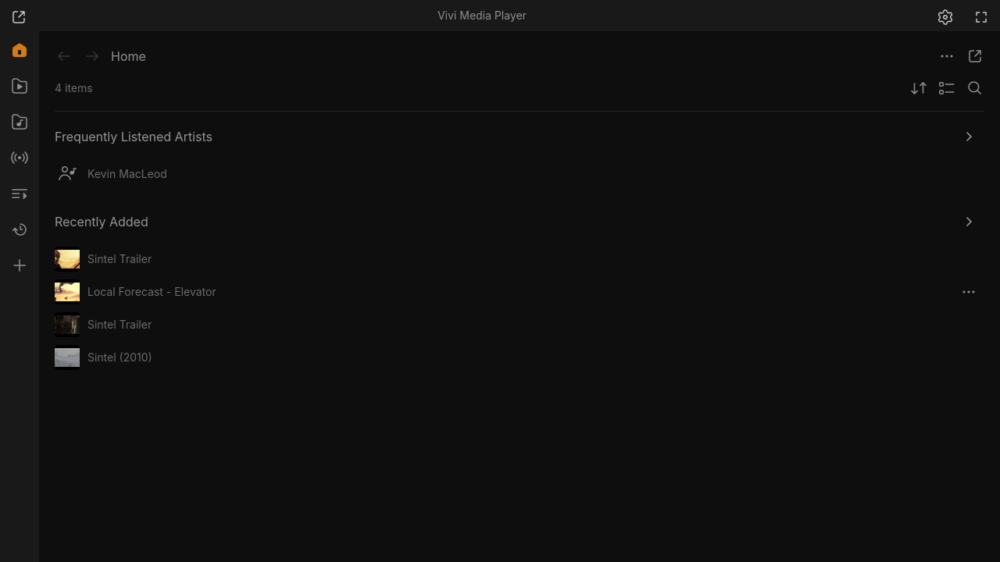
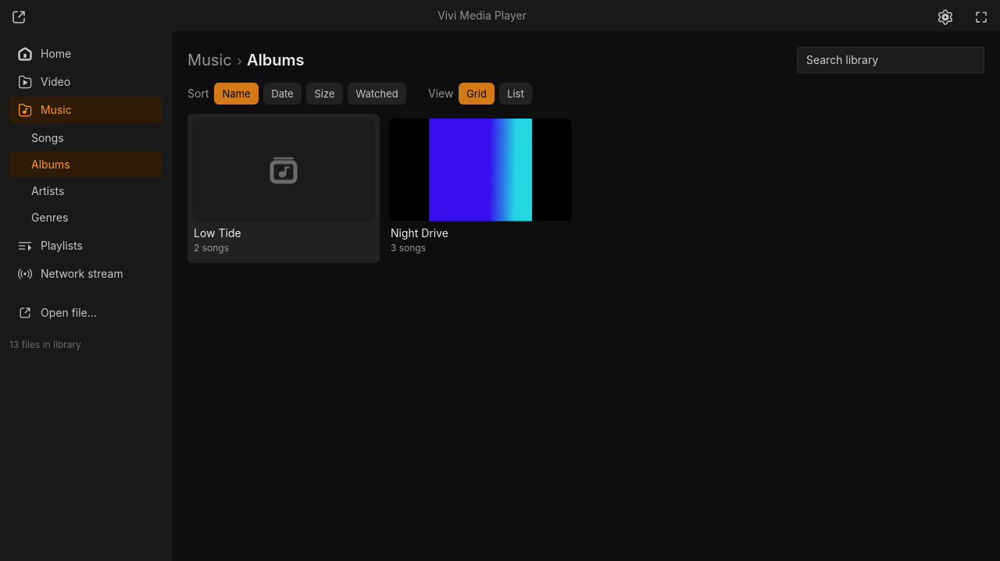

# Vivi

A fast, lightweight media player written in Rust (Slint + libmpv), inspired by
[Juxtopposed's VLC redesign](https://www.youtube.com/watch?v=ERFeOgqk324). Goals: under 100 MB,
instant startup, a simple interface by default with deep customization when you want it.


## Features
- Plays nearly any format via libmpv (OpenGL render API), `hwdec=auto-safe`
- Wayland (Hyprland) and X11 — Slint winit + femtovg backend
- UI based on the Figma "VLC Redesign": thick seek bar with hover time, Figma icons, dark theme
- Controls and cursor auto-hide after 2 s of inactivity; subtitles move above the bar when it's shown
- Side panel with **Subtitles / Audio / Video / Playback** tabs:
  - subtitle & audio track selection, external subtitle files, delays, subtitle size/position
  - audio output device, volume boost up to 150%, EQ presets
  - aspect ratio, rotation, zoom, pan & scan, brightness/contrast/saturation/gamma, hwdec toggle
  - speed, A-B loop, sleep timer, chapters, bookmarks (Ctrl+B)
- Miniplayer (`P`): compact always-on-top window (391×339 by default, resizable down to 280×160, size and position remembered) with an optional queue view; tiny sizes show the video only, with hover controls
- Responsive layout down to 480×320: the bottom bar folds extra buttons into a “⋯” menu, the side panel overlays the video (full width below 800 px), the library switches to an icon rail and list view, Settings uses a category dropdown — see [docs/screenshots/responsive](docs/screenshots/responsive)
- Seek-bar hover preview: frame thumbnails while hovering the seek bar (needs `ffmpeg`)
- MPRIS2 (Linux): media keys, `playerctl`, Waybar/desktop widgets with title, artist and cover art
- Queue (add, drop, reorder, remove), saved `.m3u` playlists, resume where you left off, recent files
- Open via file dialog (XDG portal), command line (multiple files are queued), or drag & drop (X11, Windows, macOS; on Wayland see below)
- Settings (`Ctrl+,`) with search, Basic/Advanced mode and tooltips: dark/light theme, accent color, resume, default speed, hwdec, preferred audio/subtitle languages, volume cap, subtitle size, auto-load, privacy. Saved to `~/.config/vivi/config.toml`
- Library: home screen (Continue watching, Pinned, Recently added, Recent), Video folders with breadcrumb, Music by songs/albums/artists/genres, playlists, search, sort, grid/list, right-click menu, thumbnails via ffmpeg
- Open Network Stream (URLs, m3u; YouTube etc. via yt-dlp)
- Customizable bottom bar (16 items, re-order/remove/add) with Minimal / Default / Power profiles
- First-run onboarding: theme, accent color, hotkeys intro (skippable)
- Per-show presets: delays, subtitle size/position and track languages applied automatically to every episode

| Side panel | Empty state |
|---|---|
|  |  |
| **Settings** | **Light theme** |
|  |  |
| **Library** | **Music** |
|  |  |
| **Miniplayer** | **Seek preview** |
|  |  |
| **Customize player** | **Onboarding** |
|  |  |

## Install

| Platform | Package |
|---|---|
| Arch / Omarchy | `packaging/arch/vivi-bin` (prebuilt) or `packaging/arch/vivi` (from source): `makepkg -si`. The release also ships a ready `PKGBUILD` with checksums. |
| Any Linux | `Vivi-<version>-x86_64.AppImage` (libmpv bundled): `chmod +x` and run |
| Linux tarball | `vivi-<version>-linux-x86_64.tar.gz` (needs system `mpv`) with `.desktop` file and icons |
| Windows 10/11 | `vivi-<version>-windows-x86_64.zip` — unzip, run `vivi.exe` (`libmpv-2.dll` included) |
| macOS (Apple Silicon, best effort) | `vivi-<version>-macos-arm64.zip` — unsigned `Vivi.app`; right-click → Open the first time |

Downloads: [Releases](https://github.com/Loafer19/vivi/releases) (each with `SHA256SUMS`).

### Set Vivi as the default player (Linux)
`vivi.desktop` declares the common video/audio MIME types and is installed by the packages
(for the tarball: copy it to `~/.local/share/applications/`). Then:
```sh
# all types listed in the desktop file
grep '^MimeType=' /usr/share/applications/vivi.desktop | cut -d= -f2 | tr ';' '\n' \
  | xargs -r xdg-mime default vivi.desktop
# or a single type
xdg-mime default vivi.desktop video/mp4
xdg-mime query default video/x-matroska   # → vivi.desktop
```

### Drag & drop on Wayland
winit (the windowing library under Slint) does not support drag & drop on Wayland yet.
Until it does, run Vivi through XWayland when you want to drop files onto the window:
`VIVI_X11=1 vivi` (or add `VIVI_X11=1` to the `Exec=` line of a copy of `vivi.desktop`).
Opening files from the file manager, the command line or the library works natively.

## Build from source (Arch / Omarchy)
```sh
sudo pacman -S --needed mpv sqlite rust base-devel libxkbcommon wayland mesa xdg-desktop-portal
# optional: ffmpeg (library thumbnails), yt-dlp (YouTube & other sites)
git clone https://github.com/Loafer19/vivi && cd vivi
cargo build --release
./target/release/vivi ~/Videos/film.mkv
```
Debian/Ubuntu: `sudo apt install libmpv-dev libsqlite3-dev libxkbcommon-x11-0 libfontconfig1-dev`.

Debugging: `VIVI_LOG=1` (position/track log), `VIVI_MPV_DEBUG=1` (verbose mpv log),
`VIVI_X11=1` (force XWayland).

## Keyboard shortcuts
| Key | Action |
|---|---|
| Space / K | Play / pause |
| ← / → | Seek −5 / +5 s (Shift: 60 s) |
| ↑ / ↓ | Volume ±5 |
| F, double-click | Fullscreen |
| M | Mute |
| P | Miniplayer on / off |
| Ctrl+O | Open file |
| Ctrl+B | Add bookmark |
| Ctrl+, | Settings |
| Esc | Leave miniplayer / fullscreen, close settings |

## Architecture
`src/player.rs` — libmpv wrapper (event thread → channel) · `src/render.rs` — mpv rendered under Slint ·
`ui/*.slint` — UI and design tokens · `assets/icons` — SVGs extracted from Figma.
Design notes: [docs/design/FIGMA.md](docs/design/FIGMA.md) · research: [docs/RESEARCH.md](docs/RESEARCH.md).

## Roadmap
Stages are tracked as [milestones](https://github.com/Loafer19/vivi/milestones), tasks as [issues](https://github.com/Loafer19/vivi/issues).
- [x] M1 Playback
- [x] M2 Figma UI & icons
- [x] M3 Side panel & tracks
- [x] M4 Queue / playlists / resume
- [x] M5 Settings & customization
- [x] M6 Library
- [x] M7 Packaging & desktop integration (v0.7)

## License
MIT — see [LICENSE](LICENSE). Icons come from the Figma community file "VLC Redesign" by Juxtopposed.
