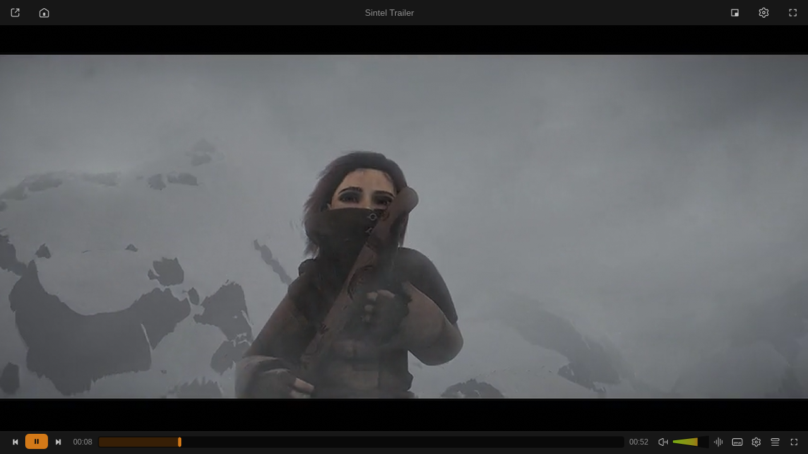

# Vivi

**A fast, beautiful media player in Rust.** Slint UI on top of libmpv: instant startup, under 100 MB, simple by default, deep when you want it.

[viviplayer.app](https://viviplayer.app) · [Plugins](https://plugins.viviplayer.app) · [Write a plugin](https://plugins.viviplayer.app/dev/) · [MCP](docs/mcp.md) · [Full feature reference](docs/features.md)



## Features
- **Plays anything** mpv plays, with hardware decoding, on Wayland, X11, Windows and macOS
- **Library**: home screen, video folders, music by album/artist/genre, playlists, resume, search
- **Side panel**: queue, bookmarks, chapters, plus quick playback/video/audio/subtitle settings
- **Equalizer & effects**, seek-bar previews (Chapter Thumbnails extension), miniplayer, music visualizer, MPRIS, light/dark themes
- **Lyrics karaoke**: full-screen synced lyrics with word highlight, Find Lyrics, save as `.lrc` or embed
- **Subtitles**: OpenSubtitles hash-first search, language chips, preview, one-click load, per-file offset, auto-sync
- **Auto-tagger**: AcoustID + MusicBrainz and more, confidence-ranked, per-field alternatives, undo; can name untagged songs as they play (nothing is written until you review)
- **Free Music**: Jamendo + Internet Archive/FMA search, album/artist pages, download queue
- **Network Streams / IPTV**: radio, iptv-org TV, M3U playlists, XMLTV now/next guide, favorites
- **Remote Control**: control playback from your phone, pair with a QR code
- **MCP**: let Claude, Cursor and other AI agents control the player ([docs/mcp.md](docs/mcp.md))
- **Plugin marketplace**: Discord, SponsorBlock, scrobbling, YouTube downloads and more, plus your own mpv scripts

## Install
Linux one-liner (Arch: builds `vivi-bin` with makepkg; elsewhere installs to `~/.local`):
```sh
curl -fsSL https://viviplayer.app/install.sh | sh
```
Or grab a file from [Releases](https://github.com/Loafer19/vivi/releases/latest) (all checked by `SHA256SUMS`):

| Platform | Asset |
|---|---|
| Arch / Omarchy | `PKGBUILD` → `makepkg -si` (or `packaging/arch/`) |
| Any Linux | `Vivi-<version>-x86_64.AppImage` → `chmod +x` and run |
| Flatpak | `vivi-<version>-x86_64.flatpak` → `flatpak install --user <file>` |
| Linux tarball | `vivi-<version>-linux-x86_64.tar.gz` (needs system mpv) |
| Windows 10/11 | `vivi-<version>-windows-x86_64.zip` → run `vivi.exe` |
| macOS (Apple Silicon) | `vivi-<version>-macos-arm64.zip` → unsigned, right-click → Open first time |

Build from source: `cargo build --release` (needs libmpv, sqlite; see [docs/features.md](docs/features.md#build-from-source-arch--omarchy)).

## License
MIT. UI based on Juxtopposed's “VLC Redesign” Figma file. Credits in [docs/features.md](docs/features.md#credits).
