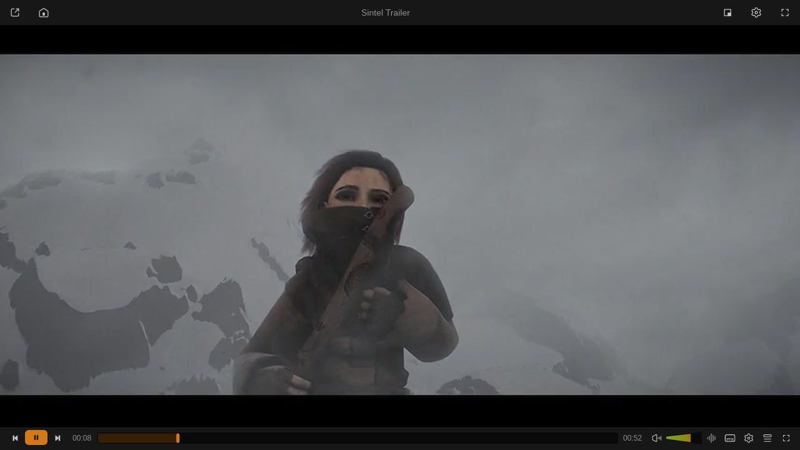

# Vivi

**A fast, beautiful media player in Rust.** Slint UI on top of libmpv: instant startup, under 100 MB, simple by default, deep when you want it.

[viviplayer.app](https://viviplayer.app) · [Plugins](https://plugins.viviplayer.app) · [Write a plugin](https://plugins.viviplayer.app/dev/) · [MCP](docs/mcp.md) · [Full feature reference](docs/features.md)



## Features
- **Plays anything** mpv plays, with hardware decoding, on Wayland, X11, Windows and macOS
- **Library**: home screen, video folders, music by album/artist/genre, playlists, resume, search
- **Side panel**: queue, bookmarks, chapters, plus quick playback/video/audio/subtitle settings
- **Equalizer & effects**, seek-bar previews (Chapter Thumbnails extension), miniplayer, music visualizer, MPRIS, light/dark themes
- **Lyrics karaoke**: full-screen synced lyrics in Stage, Classic (two-line) or Neon styles, with blurred cover art or dimmed visualizer backgrounds, per-session semitone pitch shift, word highlight, click a line to jump there, Find Lyrics, save as `.lrc` or embed; music-service songs and radio streams too
- **Subtitles**: OpenSubtitles hash-first search, language chips, preview, one-click load, per-file offset, auto-sync
- **Auto-tagger**: AcoustID + MusicBrainz and more, confidence-ranked, per-field alternatives, undo; can name untagged songs as they play (nothing is written until you review)
- **Free Music**: Jamendo + Internet Archive/FMA search, album/artist pages, download queue (Internet Archive/FMA; Jamendo links to its site)
- **Network Streams / IPTV**: radio, iptv-org TV, M3U playlists, XMLTV now/next guide, favorites
- **Remote Control**: control playback from your phone, pair with a QR code
- **MCP**: let Claude, Cursor and other AI agents control the player ([docs/mcp.md](docs/mcp.md))
- **Plugin marketplace**: Discord, SponsorBlock, scrobbling, YouTube downloads and more, plus your own mpv scripts

## Install
Linux one-liner (Arch: builds `vivi-bin` with makepkg; elsewhere installs to `~/.local`):
```sh
curl -fsSL https://viviplayer.app/install.sh | sh
```
Or grab a file from [Releases](https://github.com/Loafer19/vivi/releases/latest) (all checked by `SHA256SUMS`):

| Platform | Asset |
|---|---|
| Windows 10/11 | `vivi-<version>-windows-x64-setup.exe` (or `-arm64-`): per-user installer, Start menu shortcut |
| Windows portable | `vivi-<version>-windows-x64-portable.zip` (or `-arm64-`) → run `vivi.exe` |
| Any Linux | `vivi-<version>-linux-x64.AppImage` (or `-arm64`) → `chmod +x` and run |
| Flatpak | `vivi-<version>-linux-x64.flatpak` → `flatpak install --user <file>` |
| Linux tarball | `vivi-<version>-linux-x64.tar.gz` (or `-arm64`; needs system mpv) |
| Arch / Omarchy | `packaging/aur/vivi-bin` → `makepkg -si` (or the install script above) |
| macOS (Apple Silicon) | `vivi-<version>-macos-arm64.zip` → unsigned, right-click → Open first time |
| NixOS / Nix | `nix run github:Loafer19/vivi` (Linux; or `nix build` / `nix develop` in a checkout) |

Build from source: `cargo build --release` (needs libmpv; see [docs/features.md](docs/features.md#build-from-source-arch--omarchy)).

NixOS: `nix run github:Loafer19/vivi`. The flake wraps the GUI libraries Vivi loads at runtime; it does not bundle `ffmpeg` or `yt-dlp`. Those are optional: a system `ffmpeg` on PATH is used for library thumbnails and album covers, and the YouTube plugin can install a managed yt-dlp (and a small ffmpeg when a download needs to merge or convert). Local playback does not need either.

## License
MIT. UI based on Juxtopposed's “VLC Redesign” Figma file. Credits in [docs/features.md](docs/features.md#credits).
